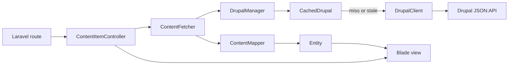

# Architecture

A request for a content page passes through one route, one controller and a small stack of services that fetch, cache and map Drupal's JSON:API into an [Entity](./vocabulary.md#entity) for your view. This page shows that path and where you can step in.

## Before you start

Know the [descriptor](./vocabulary.md#descriptor) and the [Source](./vocabulary.md#source) terms. The [Quick start](./quick-start.md) shows the result; this page explains how it works.

## The request path

An item page is served in five steps. The diagram follows one request for `/talk/dune`, the item route of the `talk` content type.

1. **Route.** The package registers the route from your descriptor. The route carries the content type key, so the controller needs no configuration.
2. **Controller.** `ContentItemController` asks `ContentFetcher` for the item and renders the first view that exists in the [view chain](./views-and-overrides.md).
3. **Fetcher.** `ContentFetcher` takes the Source of the content type from `DrupalManager`, resolves the URL alias to a Drupal resource, then fetches that resource with the `include` paths of the content type.
4. **Cache and client.** `CachedDrupal` answers from Laravel's cache when it can. Otherwise `DrupalClient` calls Drupal. See the [Caching model](./caching-model.md).
5. **Mapper.** `ContentMapper` turns the JSON:API document into an `Entity` whose properties carry your field and relation names. Your view receives it as `$entity` and under the content type key (`$talk`).

Listings differ in one respect: `ContentListingController` fetches nothing. It renders a view that hosts the `drupal::listing` Livewire component, and the component calls `ContentFetcher` for each page. Search follows its own path, described in [Search setup](./search-setup.md).

## The building blocks

| Class | Role |
|---|---|
| `Descriptor` | The validated, immutable form of `config/drupal-backend.php`. Everything else reads from it. |
| `DrupalManager` | Hands out one `CachedDrupal` per Source and flushes Sources. |
| `CachedDrupal` | Caches decoded JSON:API documents for one Source. It never caches models. |
| `DrupalClient` | Sends HTTP requests to one Drupal site, with timeouts and retries. |
| `ContentFetcher` | Fetches items, listing pages and filter options for any content type. |
| `ContentMapper` | Maps a JSON:API document to an `Entity`. |
| `SearchFetcher` | Plans every tab through the bound `SearchBackend` and sends one batch. |
| `SearchBackend` | The search seam. The default, `NativeSearchBackend`, answers from native collections. |
| `RelatedContent` | Validates a `RelatedRequest` and asks the bound `RelatedStrategy`. |

The container binds `Descriptor`, `DrupalManager`, `CachedDrupal`, `DrupalClient` and `ContentMapper` as singletons, and `SearchBackend` and `RelatedStrategy` to their native implementations. The value objects of the seams (`TabSearch`, `TabPlan`, `TabResult`, `Capabilities`, `RelatedRequest`, `Criterion`) are `final readonly` and stable, so an extension can rely on them. `CachedDrupal` and `DrupalClient` resolve to the default Source, so code that names no Source gets that one. Inject `ContentFetcher` in your own controllers to fetch content without the package's routes.

## How the package boots

1. `register()` merges the package's default config under yours and binds the services above.
2. `boot()` registers the `drupal` view, Livewire and Blade component namespaces, and the three Artisan commands when the app runs in the console.
3. When `content_types` is not empty, the descriptor is built and validated. This is the moment a broken descriptor fails.
4. The package defines three rate limiters (`content`, `search-suggest`, `drupal-webhook`) and registers its routes. Content routes are skipped when `routes.auto` is `false`; call `Route::drupalContent()` where you want them instead. The webhook route never joins the `web` middleware group, so it has no session and no CSRF check.

With no content types, the package does none of steps 3 and 4.

## Where you can step in

| Extension point | Use it to |
|---|---|
| View overrides | Replace any default view. See [Views and overrides](./views-and-overrides.md). |
| `Entity` subclass | Add presentation helpers to a content type. Set it as `entity` in the descriptor. |
| `SearchBackend` | Rebind or `extend()` it to change how each search tab is answered. `plan(TabSearch)` returns the tab's requests and how to read their responses; `capabilities()` says what it can do. `SearchFetcher` stays concrete and sends every plan as one concurrent batch. See [Search setup](./search-setup.md). |
| `RelatedStrategy` | Rebind or `extend()` it to change how related items are chosen. `RelatedContent` validates the request, then calls it. See [Related content](./related-content.md). |
| `BackendCheck` | Tag a class `drupal-backend.checks` to add a live check to `drupal:validate`, run once per Source. |
| `ContractContributor` | Tag a class `drupal-backend.contract` to add modules, per-type lines or sections to `drupal:contract`. |
| `Route::drupalContent()` | Place the content routes yourself, for example inside your own middleware group. |
| `RateLimiter::for()` | Redefine one of the three rate limiters after the package boots. |
| `FakesDrupal` | Build JSON:API documents for tests. See [Testing](./testing.md). |

## When Drupal fails

Every failure becomes one of three exceptions, all extending `DrupalException`. Each renders your `errors.{status}` view first, then the package's `drupal::error`. The outcomes are defined in the [Vocabulary](./vocabulary.md#failures).

| Exception | Status |
|---|---|
| `DrupalNotFound` | 404 |
| `DrupalUnavailable` | 503 with `Retry-After: 30` |
| `DrupalBadResponse` | 502 |

## Next steps

- Learn how responses stay fresh in the [Caching model](./caching-model.md).
- Declare your content in [Mapping content](./mapping-content.md).
- Install the package with [Installation](./installation.md).
