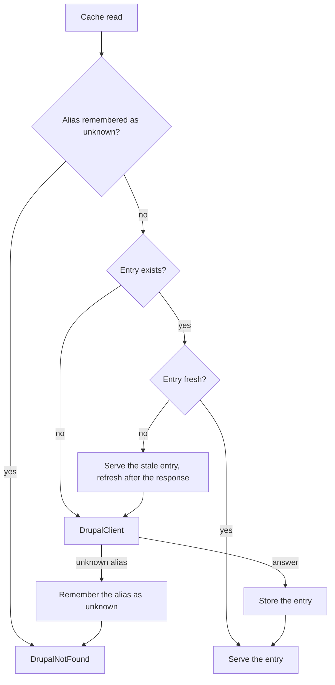

# Caching model

The package caches Drupal's JSON:API documents in Laravel's cache. Entries stay fresh for minutes, stay available for a day, and a single counter, the [content generation](./vocabulary.md#content-generation), invalidates all of them at once.

## Before you start

Choose a [cache store](./installation.md#choose-a-cache-store). Know the [fresh and stale window](./vocabulary.md#fresh-and-stale-window) and the [negative cache](./vocabulary.md#negative-cache) terms.

## How a lookup works

Every read goes through `CachedDrupal`. The diagram shows one lookup, from the check for an unknown alias to the stored entry.

- **Fresh hit.** The entry is younger than `drupal.cache.fresh`. It is served without a call to Drupal.
- **Stale hit.** The entry is older than the fresh window but younger than `fresh + stale`. Your visitor gets the stale copy immediately, and Laravel refreshes it after the response is sent. If the refresh fails, the stale copy stays.
- **Miss.** No entry exists. The request waits for Drupal. If Drupal fails, the visitor sees the [failure outcome](./vocabulary.md#failures), because there is nothing stale to serve.
- **Unknown alias.** Drupal answered 404 for an alias, so the package remembers it for `drupal.cache.negative` seconds. Repeated requests for that URL skip Drupal.

The "alias remembered" check applies only to alias resolution; item and collection reads start at "Entry exists?".

## What is cached

| Layer | Window | Notes |
|---|---|---|
| Items and listing pages | Fresh, then stale | Stale-while-revalidate, also serves stale when Drupal fails. |
| Alias resolution | Fresh, then stale | Stores the Drupal resource that an alias points to. |
| Unknown alias | `drupal.cache.negative` | Only an answer of not found is remembered. |
| Search results | `search.cache` seconds, fresh only | No stale copy, no serving stale on errors. `0` disables it. |
| Search suggestions | Not cached | They always ask Drupal. |

The package never caches an unavailable or bad response, and it does not remember an alias that resolved to a different content type.

## The content generation

Every cache key has the form `drupal:{source}:{generation}:{hash}`. The hash covers the request: resource, query, limit and offset for a collection, or resource, UUID and query for an item.

Each Source has its own generation, a UUID stored without an expiry under `drupal:generation:{source}`. Replacing the UUID changes every key of that Source, so old entries stop being found. The package deletes nothing; old entries expire on their own after the stale window. This needs no tags, so it works on every cache store.

You replace a generation in two ways:

- The signed [webhook](./webhook-and-cache-flushing.md) from Drupal, whenever content changes.
- `php artisan drupal:flush`, which flushes every Source, or `php artisan drupal:flush reviews` for one.

A Source can list other Sources under `flush.also.sources`. Flushing it flushes those too. See [Multiple Drupal sources](./multiple-drupal-sources.md).

Until you set up the webhook, content updates reach visitors when the fresh window ends, at most `drupal.cache.fresh` seconds after the change.

## Settings

| Name | Type | Default | Effect |
|---|---|---|---|
| `drupal.cache.enabled` | bool | `true` | `false` skips every layer, including search. Use it in local development. |
| `drupal.cache.fresh` | int | `300` | Seconds an entry is served without revalidation. |
| `drupal.cache.stale` | int | `86400` | Seconds past the fresh window that a stale copy is still served. |
| `drupal.cache.negative` | int | `60` | Seconds an unknown alias is remembered. |
| `drupal.cache.store` | ?string | `null` | Cache store for package entries. `null` uses the default store. |
| `search.cache` | int | `60` | Seconds a search result is served without refetching. Set in the descriptor. |

The environment variables behind these keys are listed under [Installation](./installation.md#environment-variables).

## Good to know

- The webhook remembers each accepted signature in the default cache store, even when `drupal.cache.store` names another one.
- Entries are plain JSON:API arrays, not models, so renaming a field or changing your `Entity` subclass needs no flush.
- Changing the `includes` of a content type changes the request and so the hash. The package never reads the old entries again.

## Next steps

- Connect Drupal with [Webhook and cache flushing](./webhook-and-cache-flushing.md).
- See where the cache sits in the [Architecture](./architecture.md).
- Diagnose stale content in [Troubleshooting](./troubleshooting.md).
