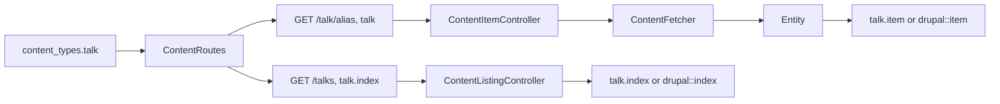

# Mapping content

Turn a Drupal content model into descriptor entries. Each entry names a Drupal bundle, the fields and relations to read, and the routes to serve. This page maps one content type end to end and contrasts two models.

## Before you start

- A working [Quick start](./quick-start.md) or an [installed package](./installation.md).
- The Drupal content type exists and anonymous users can read it. See [Backend setup](./backend-setup.md).
- Know the [role](./vocabulary.md#role) of each type: `primary`, `facet`, `page` or `reference`.

## What one entry produces

An entry under `content_types` decides the routes, the fetcher call and the views. The diagram follows the `talk` entry of the example.



The routes and view names are covered in [Routes and controllers](./routes-and-controllers.md) and [Views and overrides](./views-and-overrides.md).

## 1. Find the bundle and its fields

Open the collection in a browser to see the names Drupal uses:

```text
https://drupal.example/jsonapi/node/talk
```

Check: the response has `data` items with `attributes` such as `title` and `short_description`, and `relationships` such as `speaker`. The resource type `node--talk` gives `entity_type` `node` and `bundle` `talk`.

## 2. Declare the type and its fields

Start with identity and fields. A field reads one attribute under a name of your choice:

<<< @/snippets/fixtures/conference.php#talk{php}

- `title` is `required`: if Drupal omits it, the page is a bad response instead of rendering empty.
- `teaser` has the type `html`, so links and file paths in it point to your frontend and to Drupal's files.
- `date` has the type `date`, a string from Drupal's ISO 8601 value.

The options of each key are in the [Descriptor reference](./descriptor-reference.md#fields).

## 3. Add relations

A relation follows a JSON:API relationship. Its `via` is the relationship name in Drupal, and its `type` decides what your view receives:

| Type | Points at | View receives |
|---|---|---|
| `content` | Another content type, named by `to` | An `Entity`, or a list of them with `many` |
| `file` | A file entity, or a media type's source field | A `File` with `url`, `name`, `mime` and `size` |
| `image` | A media entity with a file | An `Image` with `src`, `alt` and image styles |

List the relations to load in `includes`. `item` is used by the item page and `listing` by listings and search rows. Load only what the view shows, because each include enlarges the JSON:API response.

Check: `php artisan drupal:contract` shows each relationship with its include path, and `php artisan drupal:validate` confirms Drupal has them.

## 4. Set the routes

Three options decide the URLs of a primary or facet type:

| Option | Talk example | Result |
|---|---|---|
| `url_prefix` | `talk` | The item page is `/talk/{alias}`. |
| `alias_prefix` | `''` | The Drupal alias is `/{alias}`, with no prefix. |
| `listing_path` | `/talks` | The listing is `/talks`, named `talk.index`. |

The two prefixes are independent. The URL prefix is what visitors see; the alias prefix is what Drupal stores. Without either, both default to the content type key.

## Contrast: a different model

The article fixture maps a Drupal site with different habits. Here the Drupal alias already contains the prefix (`/articles/my-story`), so both prefixes are `articles`, and some relations are optional:

<<< @/snippets/fixtures/article.php#article{php}

| Aspect | Talk example | Article example |
|---|---|---|
| Alias in Drupal | `/dune` | `/articles/my-story` |
| Item URL | `/talk/dune` | `/articles/my-story` |
| Image relation | `cover`, required | `hero`, optional: dropped and logged if it fails |
| Other types | `speaker` (primary, not searchable), `topic`, `track` (facets) | `writer` (primary, not searchable), `topic`, `genre` (facets); only `writer` and `genre` have listings |
| Search | Enabled with tabs | Not configured |

Neither model needs package code. The package reads your descriptor and nothing else.

## Read the result in a view

A view receives the entity under the content type key and as `$entity`. Fields and relations have the names you chose:

```blade [resources/views/talk/item.blade.php]
<h1>{{ $talk->title }}</h1>
{!! $talk->teaser !!}
```

An unknown name throws instead of returning empty, so a typo fails loudly in development. Every entity also has `id`, `type`, `path` and `url()`.

## Next steps

- Serve the pages in [Routes and controllers](./routes-and-controllers.md).
- Write the templates in [Views and overrides](./views-and-overrides.md).
- Add similar items with [Related content](./related-content.md).
