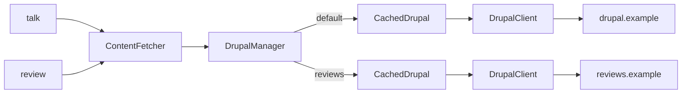

# Multiple Drupal sources

Read content from more than one Drupal site. Each site is a [Source](./vocabulary.md#source) with its own base URL, cache generation and webhook. A content type belongs to one Source, so a talk can come from the main site and its review from another.

## Before you start

- Both sites meet the [Backend setup](./backend-setup.md) requirements for the content types you read from them.
- The package is [installed](./installation.md) and works with one Source.

## How Sources fit together

Every content type resolves to a Source, and each Source gets its own cache and client. The diagram shows the talk and its review.

Each `CachedDrupal` has its own [content generation](./vocabulary.md#content-generation). Flushing one Source does not touch the other unless you link them.

## 1. Declare the Sources

Add a second entry under `sources`. Besides its base URL, the reviews site here has its own JSON:API path and frontend address:

<<< @/snippets/fixtures/conference.php#sources{php}

The `default` Source serves every content type that sets no `source`. Name another with `default_source` if none is called `default`.

Check: `php artisan drupal:validate` prints a section for each Source.

## 2. Assign a content type to a Source

Set `source` on the content type. A `reference` type is the usual case: it has no routes and is fetched through a field of another type.

<<< @/snippets/fixtures/conference.php#review{php}

`referenced_by` says that a talk's `review_id` field holds the review's UUID. The holder must declare that field.

## 3. Fetch the reference in a view

`ContentFetcher::reference()` loads the item from its own Source. It returns `null` when the id is empty, the item is missing or the site is unreachable, so a broken second site never breaks the page:

<<< @/snippets/multiple-sources/review.blade.php{blade}[resources/views/talk/item.blade.php]

Links inside the review point to the reviews site's `frontend_url` when you set one, and to `APP_URL` otherwise.

## 4. Configure webhooks and flushing

Each Source has its own secret and its own webhook URL:

| Source | Webhook URL |
|---|---|
| `default` | `POST /hooks/drupal` |
| `reviews` | `POST /hooks/drupal/reviews` |

A webhook flushes the Source it names. Use `flush.also.sources` to flush others at the same time, for example when pages of one site render content from the other. It follows chains and handles cycles.

<<< @/snippets/multiple-sources/drupal-backend.php{php}[config/drupal-backend.php]

`php artisan drupal:flush` flushes every Source. `php artisan drupal:flush reviews` flushes `reviews` and the Sources it also flushes.

## 5. Tune each Source

A Source can override the shared HTTP settings with `timeout`, `connect_timeout`, `retries` and `retry_delay_ms`, as `reviews` does above. Cache windows cannot be set per Source.

| Setting | Scope | Where |
|---|---|---|
| Timeouts and retries | Shared, or per Source | `drupal.*`, or the Source |
| Cache windows and store | Shared | `drupal.cache.*` |
| Webhook secret and tolerance | Per Source | `sources.*.webhook` |
| Search and suggestions | The default Source | `default_source` |

## Behaviour to know about

- A missing webhook secret on the default Source fails `drupal:validate`. On another Source it only warns, because that Source then stays unflushed by Drupal.
- Search and suggestions read the default Source, so searchable types and the types they relate to belong there. Related content cannot span Sources.
- Each Source needs the Decoupled Router module if it serves routed content types. A reference reached by UUID does not use it.

## Next steps

- Send change notifications in [Webhook and cache flushing](./webhook-and-cache-flushing.md).
- See how the cache separates Sources in the [Caching model](./caching-model.md).
- Look up every Source key in the [Configuration reference](./configuration-reference.md#sources).
