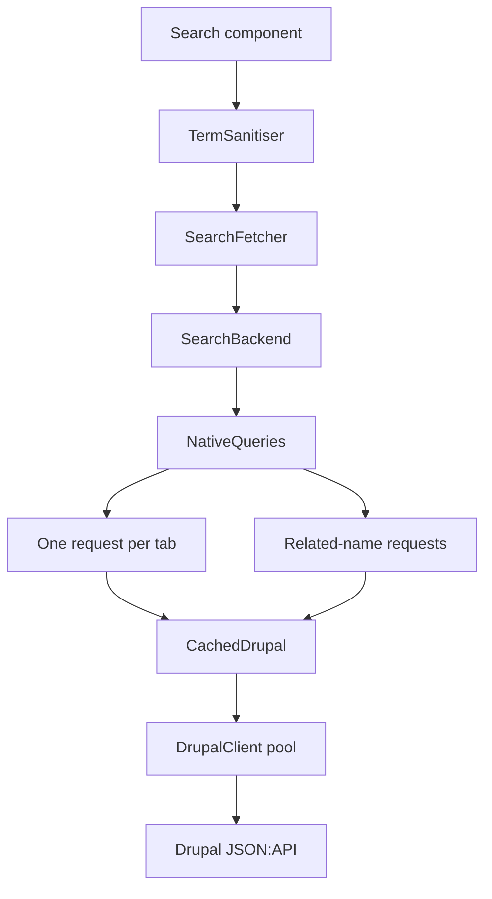

# Search setup

Add a search page with result tabs, filters and sorting. A visitor types a term or picks a filter, and the package searches Drupal and shows counts per tab. This page turns search on, explains how a query runs and shows how to dress the page.

## Before you start

- Native JSON:API collections, with the modules from [Backend setup](./backend-setup.md#_1-enable-the-modules). Search needs no other Drupal module.
- At least one `searchable` content type; each one is a tab. `term_fields` default to the title attribute.
- Every `equals` and `year_range` filter and every `boolean` field names its path on the native collection; every `conditions` rule names an `attribute`.

## 1. Turn search on

Set `search.enabled` and list the tabs. The talk example has four: talks, speakers, topics and tracks.

<<< @/snippets/fixtures/conference.php#search{php}

Any number of types can be searchable. Each tab is a searchable type, listed once, in display order; `search.tabs` is optional and defaults to the searchable types in descriptor order. The first tab is the default one.

The page is registered at `{routes.prefix}/search` as route `search`. Suggestions are registered at `search/suggest`. See [Search suggestions](./search-suggestions.md).

## 2. Say what to match

A typed term is looked for in the native collections with `CONTAINS`, so partial words match. Name the Drupal paths and their weights on each searchable type; without `term_fields` the title attribute counts 1:

<<< @/snippets/search/drupal-backend.php{php}[config/drupal-backend.php]

A hit in `title` counts 5, a hit in `body.value` counts 1. Add `related_term_fields` such as `speaker.title` to match names of related items. Each one costs one more request.

Check: `php artisan drupal:validate` reports each `CONTAINS` path, each filter path and each sort as accepted by the native collection.

## 3. Host the search component

The package's `drupal::search` view is bare HTML. Override it with a view named `search` that wraps the Livewire component in your layout:

<<< @/snippets/search/search.blade.php{blade}[resources/views/search.blade.php]

Check: open `/search?q=dune`. The form shows, results appear with a count per tab, and the address keeps `q`.

## 4. Shape a result row

Each tab renders its rows with `livewire.search.{tab}` and falls back to `drupal::livewire.search-item`. Create a view named after the tab key. The row receives `$item` and `$highlight`, the sanitised terms:

<<< @/snippets/search/livewire/search/talk.blade.php{blade}[resources/views/livewire/search/talk.blade.php]

`<x-drupal::highlight>` marks every term in the text with `<mark>` and escapes the rest. To replace the whole form, name a view `livewire.search`. All view names are in [Views and overrides](./views-and-overrides.md#how-a-view-is-chosen).

## 5. Using boolean fields as checkbox filters

A `boolean` filter renders one checkbox per entry of `fields`. Each checkbox is its own URL parameter, such as `?recording=1&slides=1`, and only a checked box filters. `match` decides how checked boxes combine: `any` selects talks where at least one is true, `all` where every one is.

A field takes one of two shapes:

| Field | The box selects items where | Sent to Drupal as |
|---|---|---|
| `['native' => 'has_recording']` | the path is true | `filter[has_recording]=1` |
| `['native' => 'slides_resources', 'present' => true]` | the path has a value | `IS NOT NULL` condition |

Use `present` for a flag Drupal computes and cannot filter on, such as "has at least one related slide deck". The path can be any field or relationship the native collection filters on. `labels` names each checkbox by its parameter; without a label the checkbox shows the parameter name as a headline (`slides` becomes "Slides").

A content type can declare any number of boolean filters, and each filter takes any set of fields: unrelated flags, relationships or a mix of both. Every filter has its own `label`, `labels` and `match`, so the sample below renders two groups of checkboxes, "Extras" (any of) and "Audience" (all of). Filters narrow together: a talk must satisfy every filter that has a checked box.

<<< @/snippets/search/boolean-filter.php{php}[config/drupal-backend.php]

Parameter names must be unique across all filters of all types and cannot be `q`, `sort`, `tab` or `page`. Check: `php artisan drupal:validate` probes each path with the same filter the box sends, then open `/search?slides=1`; only talks with a slide deck remain, and the checkbox shows checked. A boolean path that exists only in an index needs the [Index extension](./index-extension.md).

## How a search runs

The component cleans the typed term, then `SearchFetcher` asks the bound `SearchBackend` for a plan per tab and sends all the plans' requests as one concurrent batch: a page for the shown tab and a count for every other tab. One failed request fails the search.

The shown tab loads its items; the others only need a count. The batch is cached for `search.cache` seconds, and cache keys include the content generation, so a flush clears search results too.

### Which request answers

| Search | Each tab |
|---|---|
| A typed term | Native collection, `CONTAINS` per word on `term_fields`, plus one request per `related_term_fields` path, merged and scored here |
| Filters only, no term | Native collection with the filters, real `page[offset]` paging |

While a filter is active, only the tabs of the types that declare an active filter are searched. With none, every tab is searched with the term and its own [conditions](./descriptor-reference.md#conditions).

### Cleaning the term

The term is cleaned before it reaches Drupal. What the visitor typed stays in the URL and the form.

| Rule | Setting |
|---|---|
| Fewer letters or digits than the minimum is unusable | `term.min`, 2 |
| Characters kept | `term.max`, 100 |
| Words kept | `term.max_words`, 10 |
| Lowercased, so `AND`, `OR` and `NOT` are plain words | none |
| Lucene reserved characters become spaces; an unbalanced quote is removed | none |
| `"quoted phrases"` stay one term | none |

A search runs when the term is usable or at least one filter is active. A term that is too short shows a message that follows `term.min`: with `min` 3 it reads "Enter at least 3 letters or numbers." In your own views call `SearchForm::tooShortMessage()` instead of writing the text.

### Counts and paging

A native collection returns no total, so a tab count is exact only when the package has seen every match. A count it cannot confirm is a floor and the tab reads `Talks (8+)` instead of `Talks (8)`. Tabs are never hidden for being inexact. Views read `exact` on each count; `Listing::total` is `null` when it is unknown.

- **Typed term.** Each request returns at most `search.native_limit` results, 50 at most. The matches found are merged, scored and sliced in memory for paging. When a request was cut off at the limit (its `links.next` is set), the count is a floor.
- **Filters only.** The package pages with `page[offset]`. The count is the offset plus the items shown, plus one while `links.next` says there is more, so it reads `N+` until the last page.
- **Conditions.** An entry that fails a condition without `filterable` is removed after fetching, so a page may come back short.

### Relevance and sorts

Relevance is calculated here from your weights, so it is an approximation of what a search engine would rank. Without a term `relevance` is not offered; the default sort is then the first name in `sorts`, or the title attribute when the type declares none.

## Core only or with the index extension

Core answers every search from native collections. Install [`proteo/drupal-search-api`](./index-extension.md) when those limits matter.

| | Core only | With the index extension |
|---|---|---|
| Typed term | `CONTAINS` on `term_fields`, up to `native_limit` matches per request | The same, or whole-word `index_fulltext` from the index |
| Count | `N` when every match was seen, `N+` otherwise | Exact (`meta.count`) |
| Filters only | Native, paged with `page[offset]` | Answered from the index |
| Boolean filter | Needs a native path | Also a column that exists only in the index |
| Drupal modules | JSON:API | JSON:API, Search API and JSON:API Search API |

## Filters, sorts and state

Filters (`equals`, `year_range`, `boolean`) and sorts belong to the type that declares them and apply on its tab only. See the [Descriptor reference](./descriptor-reference.md#filters). The component keeps its state in the URL: `q`, `tab`, `sort`, one parameter per filter, and `page`, so every result page can be shared. Invalid filter values are dropped and shown as a message; they never reach Drupal.

The sorts a tab offers are `relevance` (with a term), `title` and the names in `sorts`. A sort that does not fit a tab falls back to that tab's default.

Switching tabs keeps the term, resets the page and drops the filters and the sort the new tab does not declare.

When a search is submitted with no filter active and the first tab has no results, the component switches to the first tab that has results. Clicking a tab or a page never moves the visitor.

## Next steps

- Offer type-ahead with [Search suggestions](./search-suggestions.md).
- Lift the native limits with the [Index extension](./index-extension.md).
- Look up every setting in the [Configuration reference](./configuration-reference.md#search).
- Fix empty results with [Troubleshooting](./troubleshooting.md).
