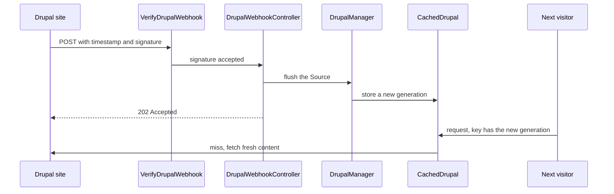

# Webhook and cache flushing

Drupal tells the frontend when content changes by sending a signed POST request. The package verifies it and starts a new [content generation](./vocabulary.md#content-generation), so the next visitor gets fresh content. You can also flush by hand.

## Before you start

- A [Source](./vocabulary.md#source) with a shared secret, and a Drupal site you can add code to.
- Read the [Caching model](./caching-model.md) for what a flush does.

## What happens on a change

The diagram follows one change in Drupal. The request returns before any content is refetched; the work happens on the next visit.



The request body is ignored: any valid request flushes the Source and every Source listed in its `flush.also.sources`. Drupal sends one request per web request that changed content, after the database commit.

## 1. Set the secret

Give each Source that Drupal can notify a secret. Use a long random value and store it in `.env`:

```bash
php -r 'echo bin2hex(random_bytes(32)), PHP_EOL;'
```

```ini [.env]
WEBHOOK_SECRET=paste-the-value-here
```

The [Installation](./installation.md) snippet reads it into `sources.default.webhook.secret`. Check: `php artisan drupal:contract` shows the webhook line `POSTs to <frontend URL>/hooks/drupal`, not "inert".

While a Source has no secret, its webhook answers 404 and nobody can discover it.

## 2. Send the request from Drupal

`php artisan drupal:contract` prints the full list of what Drupal must do. In short:

- Implement the insert, update and delete hooks for every entity type the frontend renders, plus `media` and `file` when you use images.
- Collect the changes of one request and send them once, after the commit.
- Sign the exact body bytes and send the two headers below.
- Never let a failure break editing.

This reference sender implements all four points. Adapt the entity types and settings to your module.

<<< @/snippets/webhook/FrontendFlushSender.php#sender{php}[cache_webhook/src/FrontendFlushSender.php]

Check: edit a page in Drupal, then look for the log line `Drupal content cache flushed by webhook` in the frontend.

## Where the request goes

| Source | URL |
|---|---|
| Default Source | `POST {webhook.path}`, `/hooks/drupal` unless you change it |
| Any other Source | `POST {webhook.path}/{source}`, for example `/hooks/drupal/reviews` |

The source name may contain letters, digits, `_` and `-`. Success answers `202 Accepted` with an empty body.

## How the frontend verifies the request

Before these checks, the `drupal-webhook` rate limit applies. The package then checks in this order and stops at the first failure. Each refusal logs a warning `Drupal webhook rejected` with the reason and client IP, never the secret or signature.

| Order | Check | Status | Logged reason |
|---|---|---|---|
| 1 | The Source named in the URL exists and has a secret | 404 | `secret_not_configured` |
| 2 | `X-Drupal-Timestamp` is digits and within the tolerance of the server clock | 401 | `timestamp_invalid_or_outside_tolerance` |
| 3 | `X-Drupal-Signature` equals the hex HMAC-SHA256 of `{timestamp}.{raw body}` with the secret | 401 | `signature_mismatch` |
| 4 | The signature has not been accepted before | 401 | `replayed_signature` |

Notes:

- **Tolerance.** The Source's `webhook.tolerance`, else the global `webhook.tolerance`, else 30 seconds. Keep the Drupal server's clock in sync.
- **Replay memory.** The package remembers each accepted signature for twice the tolerance in the application's default cache store. It ignores `drupal.cache.store` here, so the default store should be shared by all your web servers.
- **Rate limit.** 60 requests per minute per client IP, set by `limits.drupal_webhook`. Beyond it the route answers 429 before any verification.
- **No session.** The route is outside the `web` middleware group, so it has no CSRF check. Global middleware still runs.

## Test the endpoint by hand

Sign a body the same way Drupal does, then send it:

```bash
body='{"changes":[]}'
ts=$(date +%s)
sig=$(printf '%s.%s' "$ts" "$body" | openssl dgst -sha256 -hmac "$WEBHOOK_SECRET" -hex | sed 's/^.* //')
curl -i -X POST https://www.example/hooks/drupal \
  -H "X-Drupal-Timestamp: $ts" -H "X-Drupal-Signature: $sig" \
  -H 'Content-Type: application/json' --data "$body"
```

Check: the answer status is `202`. Sending the same command again with the same `ts` and `sig` answers 401, because the signature was already used.

## Flush by hand

```bash
php artisan drupal:flush            # every Source
php artisan drupal:flush reviews    # one Source and the Sources it also flushes
```

Check: the command prints `Drupal content cache flushed [default, reviews].` An unknown name prints `Unknown source [nope].` and exits with 1.

Flush from your deploy after a release that changes the descriptor `includes`, and from any other tool that changes Drupal without a webhook, such as a bulk import.

<details>
<summary>Rejected request in the log</summary>

```text
Drupal webhook rejected {"reason":"signature_mismatch","status":401,"ip":"203.0.113.9"}
```

</details>

## Next steps

- Connect several backends in [Multiple Drupal sources](./multiple-drupal-sources.md).
- Check the whole backend with [Validation in CI/deploy](./validation-in-ci-deploy.md).
- Diagnose a webhook that does nothing in [Troubleshooting](./troubleshooting.md).
